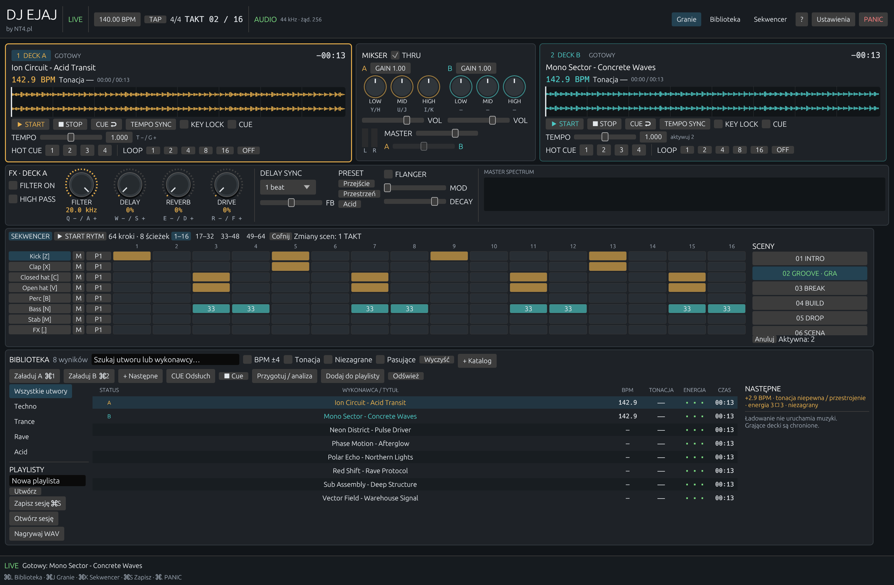
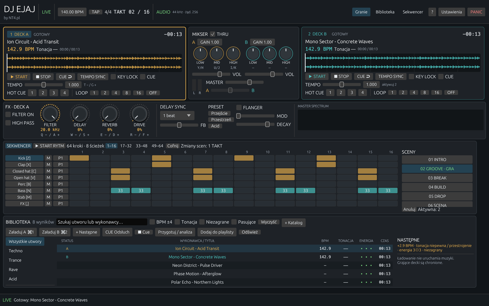

# DJejaj

Projekt lokalnej aplikacji DJ-skiej na MacBooka: dwa decki, mikser stereo,
efekty, sampler i konsola obsługiwana z klawiatury. Główne zastosowanie to
imprezowe sety techno, trance, rave i pokrewnych odmian muzyki elektronicznej.

**Status: implementacja rozwojowa 0.1.0.** Repozytorium zawiera natywną aplikację
Rust oraz dokumentację docelowej wersji. Kryteria wydania imprezowego 1.0
pozostają osobnymi bramkami odbioru; kompilacja nie oznacza ich zaliczenia.

## Zrzuty aplikacji

Konsola LIVE z dwoma deckami, mikserem, efektami, sekwencerem i biblioteką:



Widok przy szerokości okna 1280 punktów:



Obrazy przedstawiają działającą aplikację w wersji rozwojowej 0.1.0 z przykładową biblioteką.

## Dokumentacja

- [Projekt aplikacji](docs/PROJEKT.md) — funkcje, wygląd konsoli, sterowanie,
  architektura i wymagania jakościowe.
- [Etapy i kryteria odbioru](docs/ETAPY.md) — kolejność prac, scenariusze
  weryfikacji i warunki ukończenia.
- [Praca na żywo i wiedza muzyczna](docs/PRACA_NA_ZYWO.md) — przeglądanie całej
  biblioteki, bezpieczna zmiana utworów, frazy, dobór brzmień i sekwencer.
- [Repository Guidelines](AGENTS.md) — zasady pracy nad repozytorium.
- [Stan implementacji i weryfikacji](docs/IMPLEMENTACJA.md) — wykonane funkcje,
  wyniki sprawdzeń i pozostały zakres.

## Wizualizacja interfejsu

[Makieta rastrowa konsoli LIVE — PNG](docs/wizualizacje/konsola-live-v1.png)
pokazuje proponowany widok z dwoma deckami, mikserem, efektami z oznaczeniami
klawiszy, rozwiniętym sekwencerem oraz stale widoczną biblioteką i kolejką.
To propozycja wyglądu wygenerowana wbudowanym imagegen, nie zrzut działającej
aplikacji; utwory, wartości i wskaźniki są przykładowe. Szczegóły zachowania
określają dokumenty projektu. [Pełny prompt](docs/wizualizacje/konsola-live-v1.prompt.md)
jest zapisany obok grafiki, aby umożliwić przygotowanie kolejnych wariantów.

Zaimplementowana konsola ma w lewym górnym rogu wyraźne logo **DJ EJAJ**
i mały podpis **by NT4.pl**. Wcześniejsza makieta pozostaje materiałem projektowym.

## Implementacja

Rdzeń napisano w Rust: CPAL/CoreAudio, Symphonia, SQLite/FTS5, własny DSP,
Signalsmith Stretch i interfejs egui/wgpu/Metal. Workspace dzieli konsolę,
audio, efekty, bibliotekę oraz sampler na pięć modułów.

Dostępne są dwa decki, miksowanie i efekty stereo, varispeed/key lock,
biblioteka i playlisty, podpowiedzi harmoniczne, import oraz generowanie sampli,
sekwencer ze scenami, sesje i nagrywanie. W LIVE grający deck jest chroniony
przed podmianą. **TEMPO SYNC** dopasowuje prędkość do globalnego BPM;
pełna synchronizacja fazy i odbiór imprezowy są nadal otwarte.
Pełny zakres i ograniczenia opisuje [stan implementacji](docs/IMPLEMENTACJA.md).

## Uruchamianie

Gotowy pakiet: `output/DJ EJAJ.app` lub archiwum
`output/DJ-EJAJ-0.1.0-macOS-Intel.zip`.
[Krótka instrukcja pierwszego miksu](docs/SZYBKI_START.md) opisuje obsługę
bez znajomości kodu. Poniżej polecenia dla pracy z repozytorium.

Wymagane: macOS 15, Rust przypięty w `rust-toolchain.toml` oraz Xcode Command
Line Tools. Aplikacja działa lokalnie, bez serwera i konta.

```sh
sh scripts/run.sh
```

Skrypt zawsze buduje aktualną wersję release przed uruchomieniem. W konsoli
wybierz **＋ Katalog**, wskaż muzykę, zaznacz utwór i użyj **⌘1 / ⌘2** do
załadowania A/B. **Spacja** uruchamia aktywny deck; w LIVE zatrzymanie wymaga
przytrzymania **Shift+Spacja**. **⌘.** wycisza całość. **?** otwiera skróty
i parametry kroku sekwencera; **Ustawienia** pozwalają wybrać audio i klawisze.

```sh
cargo test --workspace
cargo fmt --all --check
cargo clippy --workspace --all-targets -- -D warnings
python3 scripts/package_macos.py
```

Ostatnie polecenie tworzy `output/DJ EJAJ.app` wraz z informacjami licencyjnymi
zależności. To lokalny pakiet rozwojowy; podpis i notaryzacja wydania są osobnym krokiem.

```sh
sh scripts/run.sh --demo
./target/release/djejaj --list-devices
./target/release/djejaj --export-samples output/sample-bank
./target/release/djejaj --audio-check 30
```

`--demo` generuje osiem własnych krótkich nagrań i ładuje dwa decki w pauzie.
`--audio-check` mierzy działanie callbacku na ciszy; nie mierzy opóźnienia
fizycznego ani jakości odsłuchu. Muzyka użytkownika jest tylko odczytywana.
Indeks, sesja i kopia poprzedniej sesji trafiają do
`~/Library/Application Support/DJejaj/`. Do izolowanych prób można ustawić
`DJEJAJ_DATA_DIR` na osobny katalog. Bank generowany jest przez syntezę DSP.
